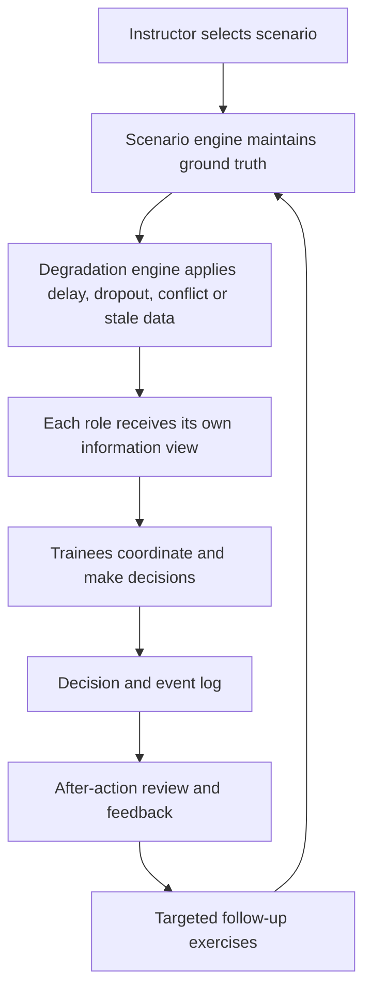

# MIRAGE

### Judgment Under the Fog of War

**An immersive multi-domain decision-making trainer for degraded communication environments.**

Smart India Hackathon 2026 · **Problem Statement: SIH26248** · Ministry of Defence (MoD) · Smart Automation · Software  
**Team:** Diogenes · **Institute:** JSS Academy of Technical Education (JSSATE), Noida

> **MIRAGE trains people to make defensible decisions when information is delayed, missing, outdated, or contradictory.** Every role receives only the information available to them, while the simulation maintains the authoritative scenario state for fair review.

> **Training simulation only:** scenarios, locations, units, reports, and events are fictional and synthetic. MIRAGE is designed to train judgment and coordination, not to model real weapons or operational electronic-warfare techniques.

---

## The problem

When communication becomes unreliable, a team may receive an outdated report, miss a critical message, or get two conflicting accounts of the same event. Traditional exercises can be difficult to repeat consistently, and post-exercise discussion can focus too heavily on the outcome instead of what each person actually knew when they made a decision.

MIRAGE creates repeatable training scenarios where teams practise evaluating information, choosing when to verify, acting under time pressure, and coordinating when each role has a different picture of the situation.

## How MIRAGE works

MIRAGE is organised into five connected layers:

1. **Scenario layer** — Runs fictional, multi-domain exercises across land, sea, and air contexts, with defined events, roles, and objectives.
2. **Degradation layer** — Applies communication and information problems such as message delay, dropout, conflicting reports, and stale information.
3. **Role-based view layer** — Delivers each trainee only their role-specific picture. The instructor can inspect the complete scenario state and see what individual roles received.
4. **Decision layer** — Trainees review the available reports and record an action, supporting evidence, confidence, and rationale. Decisions can include actions such as **Proceed, Verify, Hold,** or **Report**, depending on the scenario.
5. **Feedback and learning layer** — Reconstructs the information available at decision time, explains strengths and weaknesses, and uses observed performance to guide targeted practice and increasingly challenging exercises.



## Core features

### Realistic, repeatable scenarios

- Fictional scenarios across multiple operational domains.
- Time-based scenario events and changing conditions during an exercise.
- Communication degradation that changes the information delivered to affected roles.
- Repeatable runs to support consistent practice and comparison.

### Role-based team training

- Multiple trainees participate in the same exercise from different roles.
- Each role sees only its own available reports and communication state.
- Information can be delayed, dropped, stale, or in conflict with other reports.
- Trainees practise coordinating decisions when they do not share the same picture.

### Instructor control

- Create and run an exercise, manage participants, and control the scenario clock.
- Inject or adjust communication disruptions while the exercise is running.
- Inspect ground truth and switch to a role-specific view to understand what a trainee could see.
- Monitor decisions and communication conditions during the exercise.

### Decisions assessed in context

- Capture the selected action, confidence, rationale, and supporting evidence.
- Record decision timing and relevant scenario events.
- Distinguish a defensible decision from a lucky guess by reviewing the evidence available at the time.
- Replay the event sequence to understand how the situation developed.

### After-action review (AAR)

- Review the exercise through a structured debrief.
- Inspect individual decisions alongside the information available at decision time.
- Compare the trainee's perceived picture with the scenario's ground truth when appropriate.
- Review decision timing, verification behaviour, confidence calibration, intent adherence, communication status, and team situation awareness.
- Export reports and data as **PDF, JSON, and CSV**.

### Adaptive practice and optional AI assistance

- Use observed decision patterns to identify areas where a trainee needs more practice.
- Provide targeted follow-up scenarios and progress through increasing difficulty.
- Optional AI assistance can help instructors prepare scenario injects and produce coaching or AAR text.
- The core simulation and standard feedback remain usable without an external AI service; template-based fallback keeps the exercise flow available when AI is disabled or unavailable.

## From exercise to learning

| Stage | What happens |
|---|---|
| **Scenario** | The instructor starts a controlled, fictional exercise. |
| **Disruption** | Reports are delayed, dropped, outdated, or contradictory. |
| **Decision** | Each trainee acts using their role's available information. |
| **Debrief** | MIRAGE reviews reasoning and the information available at the time. |
| **Improvement** | Follow-up practice targets specific weaknesses and tracks performance over repeated exercises. |

## Technical approach

MIRAGE uses a browser-based client, a real-time application server, and a deterministic simulation engine. The server maintains the authoritative scenario state and delivers role-specific information to each trainee. Events and decisions are recorded so the exercise can be reviewed and replayed.

| Component | Technology / responsibility |
|---|---|
| **Frontend** | React, Vite, JavaScript/TypeScript, responsive role-specific trainee screens and instructor dashboard |
| **Real-time application layer** | Node.js, Fastify, Socket.IO for sessions and live updates |
| **Data layer** | Prisma and PostgreSQL, with an in-memory option for local development where configured |
| **Simulation engine** | Deterministic scenario state, event progression, information degradation, role-specific projection, and replay |
| **Review and exports** | After-action review, decision timelines, replay, PDF, JSON, and CSV outputs |
| **AI assistance** | Optional instructor support and coaching text with non-AI fallback |
| **Deployment** | Browser-based use on a local network or hosted environment; Docker-based deployment is supported by the project setup |

## Repository structure

```text
apps/
  web/          Browser interface for trainees and instructors
  server/       API, real-time sessions, event persistence, and AAR endpoints
packages/
  sim/          Deterministic scenario and degradation engine
  shared/       Shared event schemas, commands, and data types
scenarios/      Fictional scenario definitions
```

## Run locally

### Prerequisites

- Node.js 20 or newer
- pnpm 9
- Docker, if running the containerised setup

### Install and start

```bash
pnpm install
pnpm dev
```

Open the local web address printed by the development server. Create an exercise in one browser window and join it from additional windows or devices on the same network using the session code and assigned roles.

### Run checks

```bash
pnpm check
```

Run the end-to-end suite with:

```bash
pnpm e2e:full
```

### Run with Docker

```bash
docker compose up --build
```

The containerised setup runs the application using the repository's Docker configuration. Environment-specific values should be set in the local environment file; do not commit API keys or other secrets.

## Safety and data handling

- Scenarios and displayed operational details are fictional and synthetic.
- Role-specific trainee views do not intentionally expose the instructor's complete ground-truth view.
- Exercise records support training review, not real-world operational decision-making.
- AI assistance is optional; sensitive information and credentials should not be placed in scenario text or repository files.

## Project details

- **Project:** MIRAGE — Judgment Under the Fog of War
- **Problem Statement:** SIH26248 — Immersive Multi-Domain Decision-Making Trainer for Degraded Communication Environments
- **Organisation:** Ministry of Defence (MoD)
- **Theme:** Smart Automation
- **Category:** Software
- **Team:** Diogenes
- **Institute:** JSS Academy of Technical Education (JSSATE), Noida

---

**MIRAGE — Scenario. Degrade. Decide. Debrief. Improve.**
